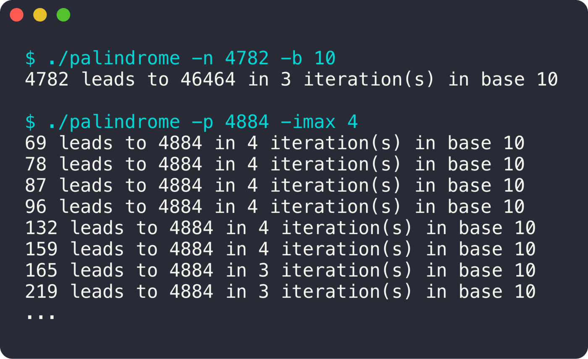

<div align="center">

# Palindrome

**Fabriquer des palindromes en additionnant un nombre et son miroir.**

 

<sub>Projet solo · 2023</sub>

</div>

<br/>

<p align="center"></p>

## En deux mots

On prend un nombre, on lui ajoute son miroir (4782 + 2874), et on recommence jusqu'à tomber sur un palindrome. Le programme fait le calcul dans les deux sens : trouver le palindrome d'un nombre, ou tous les nombres qui mènent à un palindrome donné.

## Ce que ça fait

- `-n` : le palindrome obtenu à partir d'un nombre
- `-p` : tous les nombres qui mènent à un palindrome donné
- Bornes d'itérations `-imin` / `-imax`
- Gestion d'erreurs stricte des arguments

## Sous le capot

À chaque itération, on retourne les chiffres du nombre, on les additionne au nombre et on teste si le résultat se lit pareil dans les deux sens.

## Lancer le projet

```bash
make
./palindrome -n 4782
./palindrome -p 4884 -imax 4
```
